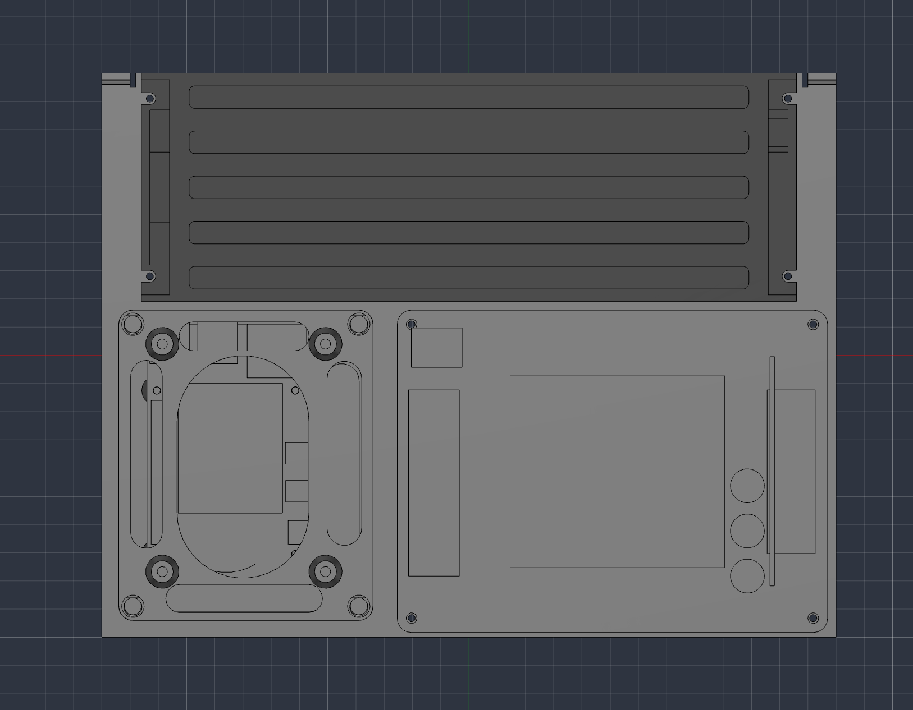
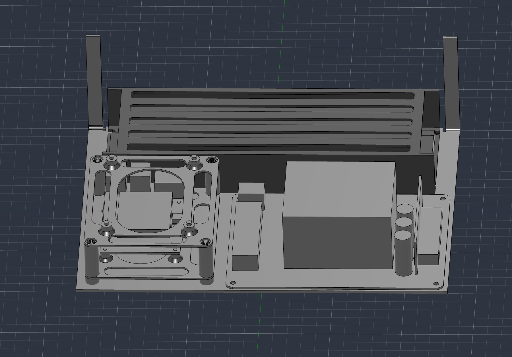

# Enclosure layout: owner-supplied views

- Archived: 2026-11-03
- Provenance: screenshots supplied by `@k3rnL` in the rear-panel design discussion.
- Revision context: enclosure discussed as Home Cinema v5; native CAD source,
  authoritative revision identifier and CAD application version were not supplied.
- Files are unchanged copies, retained as visual evidence rather than fabrication
  drawings. No dimensions have been inferred by scaling their pixels.

| View | Original attachment filename | SHA-256 |
| --- | --- | --- |
| [Top view](home-cinema-v5-top-view.png) | `codex-clipboard-e54dbd66-6564-4eec-ac68-d07897d7f09e.png` | `8b5ac104b4d2ed6ed2d7164c2ad6f94b5a1ae9ea0ea0bac66c3dcf94325db04d` |
| [Front perspective](home-cinema-v5-front-perspective.png) | `codex-clipboard-abc17d8d-1b1f-440a-ad9a-e1a66536e249.png` | `9ed12c38257f2a1798e75a2ba0abfec41be3b6211c8118cae5b93b158f19f30e` |

The owner identified the second image as viewed from the front. In the top view,
the PSU spans the upper/rear edge; Pi/electronics are lower/front left and the
amplifier is lower/front right. Exterior rear left/right is reversed.

See the [rear-panel reference](../../../docs/reference/topics/rear-panel-interface.md)
for requirements and dimensional uncertainties, and the
[session record](../../../docs/worklog/2026-11-03-rear-panel-and-audio-architecture.md)
for discussion provenance.
